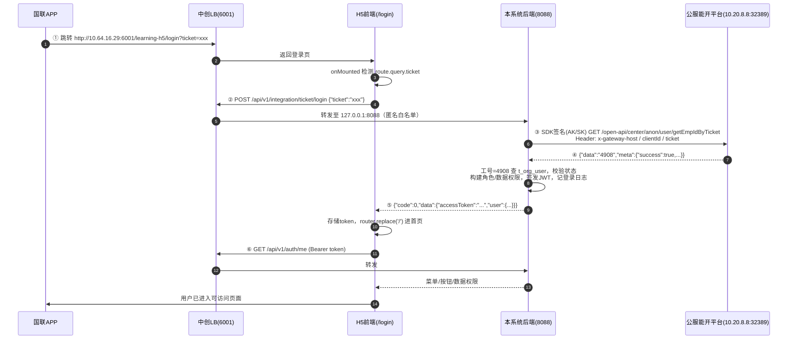

# 国联 APP 单点免密登录链路说明

> 生成时间：2026-09-07
> 适用环境：目标服务器（LB `10.64.16.29`，H5 端口 6001，后端 8088），公服测试环境 `10.20.8.8:32389`

## 一、链路总览

```
国联APP ──①跳转──> H5 登录页(/login?ticket=xxx) ──②POST ticket/login──> 本系统后端(8088)
                                                                      │  ③网关SDK(AK/SK签名)
                                                                      ▼
                                                              公服能开平台(10.20.8.8:32389)
                                                              GET /open-api/center/anon/user/getEmpIdByTicket
                                                                      │  ④返回员工ID
                                                                      ▼
本系统后端：员工ID = 工号 → 查 t_org_user → 校验状态 → 构建角色/数据权限 → 签发JWT ──⑤token+用户信息──> H5
                                                                      │
H5：存储 token → 跳转首页，后续请求携带 Authorization: Bearer ──⑥业务接口鉴权通过──> 正常访问
```

**判断结论：是的，步骤与链路如上所述，与实现一致。**

## 二、分步明细

### 步骤①：国联 APP 跳转 H5（APP 侧配置）

| 项 | 内容 |
|---|---|
| 配置在国联 APP 的链接（地址A） | `http://10.64.16.29:6001/learning-h5/login` |
| APP 实际跳转 | `http://10.64.16.29:6001/learning-h5/login?ticket=<一次性ticket>` |
| 经过 | 中创 InforSuiteLB（6001）→ 静态资源 `web/h5` |

### 步骤②：H5 前端识别 ticket 并请求后端免密登录

`web/h5` 登录页（`LoginPage.vue`）`onMounted` 检测到 URL 携带 `ticket` 参数：

| 项 | 内容 |
|---|---|
| 请求 | `POST /api/v1/integration/ticket/login`（经 LB `/api/` 反代到 `127.0.0.1:8088`） |
| 请求头 | `Content-Type: application/json`（无需登录态，接口在匿名白名单） |
| 请求体 | `{"ticket":"<ticket>","clientId":"guolian-jijian"}`（clientId 可省略，后端取配置默认值） |

### 步骤③：后端调用公服 2.1.1 接口换取员工 ID

`GuolianOpenApiClient` 使用能开平台网关 SDK（`gateway-sdk-2.6.8`，AK/SK 签名鉴权）：

| 项 | 内容 |
|---|---|
| 请求 | `GET http://10.20.8.8:32389/open-api/center/anon/user/getEmpIdByTicket` |
| 请求头 | `x-gateway-host: dflw9c81mnwwnejj.apigateway.inc.alipay.net`；`clientId: guolian-jijian`；`ticket: <ticket>`（clientId/ticket 同时在 query 携带一份，兼容不同后端实现） |
| 鉴权 | SDK 使用 AK `yv1ftGWERni3gTzN` / SK `tey40AwC64S1NJFS2K1FZ9yeG5dDKmK2` 做 HTTP 签名 |

### 步骤④：公服返回员工 ID

成功响应（透传原始报文，可在 `GET /api/v1/integration/ticket/getEmpIdByTicket?ticket=xxx` 直接查看）：

```json
{
    "data": "4908",
    "meta": { "success": true, "message": "接口调用成功", "status": 200, "exception": null }
}
```

### 步骤⑤：后端自动免密登录（TicketLoginService）

1. 解析响应，取出员工 ID（`data` 字段）
2. 按**工号 = 员工ID** 查询本地用户表 `t_org_user`（`job_no`）
3. 校验账号状态（停用/锁定拒绝；首次登录标记 `mustChangePassword`）
4. `buildLoginUser`：按用户角色构建角色编码列表 + 数据权限（所有角色最小 scope），后续接口的**菜单/按钮/数据权限**均按此鉴权
5. `TokenService.issueTokens` 签发 JWT（accessToken 12h / refreshToken 7d，Redis 存储）
6. 记录登录日志（terminal=H5，备注"ticket免密登录"）

| 项 | 内容 |
|---|---|
| 响应体 | `{"code":0,"message":"success","data":{"accessToken":"...","refreshToken":"...","mustChangePassword":false,"user":{"userId":1,"name":"张三","jobNo":"4908","orgId":1,"orgName":"...","roles":["ADMIN"],"avatarUrl":null}}}` |

### 步骤⑥：H5 前端登录成功并访问业务

1. Pinia auth store 持久化 token/user 到 localStorage
2. `router.replace('/')` 进入首页（若 `mustChangePassword=true` 则强制跳修改密码页）
3. 后续所有业务请求自动携带 `Authorization: Bearer <accessToken>`
4. 当前用户权限可随时通过 `GET /api/v1/auth/me` 获取（permissions 按钮权限、menus 菜单、dataScopeOrgId 数据权限）

## 三、时序图



## 四、前置条件与注意事项

| 项 | 说明 |
|---|---|
| 网络 | 目标服务器需放通到公服 `10.20.8.8:32389`（已验证可达） |
| 账号匹配 | 本地用户 `t_org_user.job_no` 必须与公服返回的员工ID一致，否则提示"本平台无该员工账号" |
| ticket 一次性 | ticket 由国联APP 下发且一次性有效，伪造/过期票据由公服侧校验拒绝 |
| 生产环境切换 | `application-polardb.yml` 中 `exam.integration.guolian`：`base-url` 换 `http://10.10.10.32:32389`，`gateway-host` 换 `yqhzlczrefrxswd8.apigateway.inc.alipay.net`，并换生产 AK/SK |
| 失败回退 | ticket 校验失败时 H5 停留在登录页，提示"单点登录失败，请使用工号密码登录"，可正常账号密码登录 |
